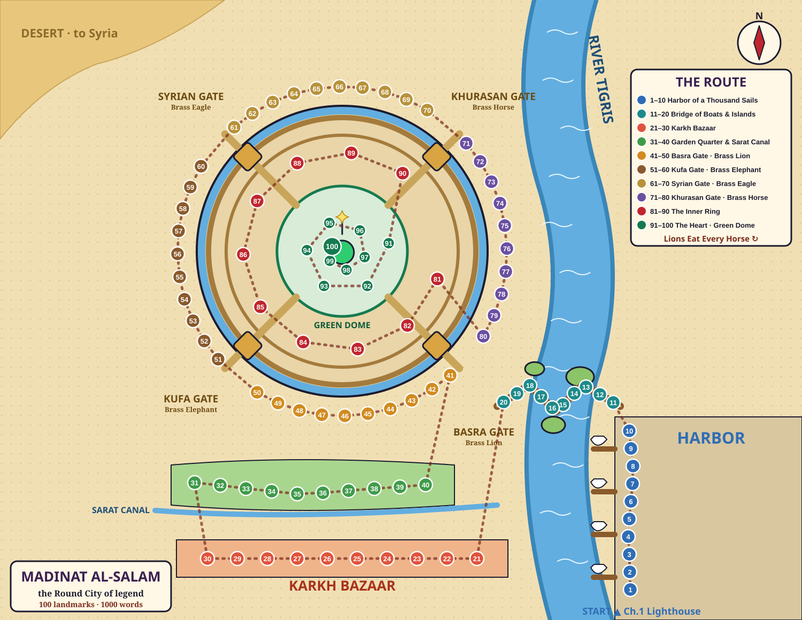

# 04 · The City Layout — Madinat al-Salam, the Round City



> **AI prompt for a painted version of the map:** *Illustrated fantasy map in vibrant comic-book style, top-down view of a legendary circular walled city of Baghdad on the west bank of a winding blue river; four ornate gates on the diagonals each topped with a giant brass animal statue (lion south-east, elephant south-west, eagle north-west, horse north-east); inner ring of palaces and a library; at the exact center a green dome with a bronze horseman on top; outside the south wall a colorful bazaar street and a garden quarter along a canal; across the river on the east bank a harbor with dhows and a crescent-shaped lighthouse; a bridge made of boats crossing the river between small islands; a desert in the north-west corner; warm parchment colors, no text.*

The whole saga takes place in one mythic city: **Baghdad as the legends tell it**, the circular "City of Peace" built on the west bank of the River Tigris, with four great gates, a green dome at its center, and a bustling harbor and bazaar outside its walls.

Readers should be able to walk this city in their heads the way a gamer knows the GTA map: *leave the lighthouse, run up the docks, cross the boat-bridge, cut through the bazaar…* Nothing moves, and nothing is ever re-ordered.

## The Big Shape (learn this first)

1. **The river** runs top to bottom on the right side of the map. The **harbor** is on its east bank.
2. **The Round City** is a huge circle on the west bank. It has **three rings**: the Outer Wall with its four gates, the Inner Ring, and the Heart.
3. **Four gates** sit on the diagonals, each guarded by a **brass animal**:
   - **Basra Gate** (south-east) with the **Brass Lion**, which tests *logic*
   - **Kufa Gate** (south-west) with the **Brass Elephant**, which tests *memory*
   - **Syrian Gate** (north-west) with the **Brass Eagle**, which tests *fairness*
   - **Khurasan Gate** (north-east) with the **Brass Horse**, which tests *self-control*
   - Memory hook: **"Lions Eat Every Horse"**, going clockwise from the south-east.
4. **Outside the wall to the south** are the **Karkh Bazaar** and the **Garden Quarter** along the Sarat Canal.

## The Route: one spiral, one hundred stops

The story walks one route, like a GTA mission path. It **snakes through the outskirts and then spirals clockwise and inward** to the center:

```
HARBOR (north along the docks) → BRIDGE OF BOATS (west over the islands)
→ KARKH BAZAAR (west along the market street) → GARDEN QUARTER (U-turn, east along the canal)
→ BASRA GATE (SE) → KUFA GATE (SW) → SYRIAN GATE (NW) → KHURASAN GATE (NE)   [clockwise around the wall]
→ INNER RING (one loop inside the wall) → THE HEART (spiral up to the Green Dome and the sky)
```

| # | District | Chapters | Words | Direction of travel | Feel |
|---|---|---|---|---|---|
| 1 | Harbor of a Thousand Sails | 1–10 | 1–100 | South → North, along the east bank | salt, ropes, lanterns, ships |
| 2 | Bridge of Boats & River Islands | 11–20 | 101–200 | East → West, across the Tigris | wobbling planks, mills, reeds |
| 3 | Karkh Bazaar | 21–30 | 201–300 | East → West, market street | noise, spices, carpets, crowds |
| 4 | Garden Quarter & Sarat Canal | 31–40 | 301–400 | West → East, canal path | roses, waterwheels, calm |
| 5 | Basra Gate (Brass Lion) | 41–50 | 401–500 | around the wall, SE → S | soldiers, hospital, mint, forge |
| 6 | Kufa Gate (Brass Elephant) | 51–60 | 501–600 | around the wall, SW → W | craftsmen: paper, glass, ink, clocks |
| 7 | Syrian Gate (Brass Eagle) | 61–70 | 601–700 | around the wall, NW → N | caravans, desert, dunes, oasis |
| 8 | Khurasan Gate (Brass Horse) | 71–80 | 701–800 | around the wall, NE → E | horses, kites, observatory, stars |
| 9 | The Inner Ring | 81–90 | 801–900 | one loop inside the wall | palaces, library, prison |
| 10 | The Heart | 91–100 | 901–1000 | spiral inward and upward | gold, fountains, the Green Dome |

**Address rule:** chapter number = landmark number. The **tens digit** tells you the district and the **ones digit** tells you the stop. Chapter 47 is district 5 (Basra Gate), stop 7 (the Blacksmiths' Forge), and its words are **461–470**.

## The Ten Stations (the same inside every landmark)

Every one of the 100 landmarks has the same ten spots, visited in the same order. Each spot is shaped to fit its building: the "Lamp" of the lighthouse is a hanging ship lantern, while the "Lamp" of the Blacksmiths' Forge is a glowing furnace.

| Station | Word slot | Where it is | Picture it as |
|---|---|---|---|
| 1 | **ARCH** | the entrance archway | walking in under it |
| 2 | **STEP** | the doorstep or first step | something you trip on |
| 3 | **LAMP** | a light on the left wall | something glowing |
| 4 | **RUG** | the floor in the middle of the room | something lying on the floor |
| 5 | **HEART** | the centerpiece of the place (fountain, throne, anvil…) | the most important object |
| 6 | **PILLAR** | a column on the right | something wrapped around it |
| 7 | **WINDOW** | a window at the back | something peeking in or out |
| 8 | **STAIR** | stairs going up | something climbing or falling |
| 9 | **BALCONY** | a balcony looking out | something leaning over |
| 10 | **TOP** | the roof or dome | something perched on the very top |

**The Station Chant**, clapped out in two beats of five:
> **ARCH – STEP – LAMP – RUG – HEART! PILLAR – WINDOW – STAIR – BALCONY – TOP!**

The walk always goes: in the door, down to the floor, into the middle, to the right, to the back, up the stairs, out on the balcony, up onto the roof. That is one natural path through any building.

**Finding any word:** word **473** is in chapter 48 (words 471–480), which is district 5, stop 8, the **Archery Range**. It is the 3rd word of that chapter, so it sits at the **Lamp**. In the story, the Lamp of the Archery Range is a flaming arrow-torch, and word 473 is *trajectory*.

## All 100 Landmarks


### District 1 · Harbor of a Thousand Sails — chapters 1–10

| Stop | Landmark | What it looks like | Words |
|---|---|---|---|
| 1 | **The Crescent Lighthouse** | a white tower shaped like a crescent moon, fire-mirror on top, at the very southern tip of the docks | 1–10 |
| 2 | **The Fish Market** | a shouting market under striped awnings, ice-baskets of silver fish, a giant swordfish skull over the door | 11–20 |
| 3 | **The Rope-Makers' Wharf** | long sheds where ropes are twisted, coils as big as houses, a rope bridge between two masts | 21–30 |
| 4 | **The Customs House** | a stern stone building with scales on the roof and a huge brass stamp at the door | 31–40 |
| 5 | **The Shipyard** | dhow skeletons standing on wooden stilts like ribs of whales, sawdust and tar | 41–50 |
| 6 | **Sinbad's Ship, the Wandering Pearl** | Sinbad's beached ship, tilted on its side, patched sails, seven flags from seven voyages | 51–60 |
| 7 | **The Pearl Divers' Pier** | a long pier with diving stones on ropes, oyster heaps and a giant clam used as a bench | 61–70 |
| 8 | **The Spice Warehouses** | brick warehouses stacked with sacks of pepper, cinnamon and saffron, a crane with a hook | 71–80 |
| 9 | **The Harbormaster's Tower** | a tall square tower with a great bronze bell and a signal-flag balcony | 81–90 |
| 10 | **The Chain Gate** | two towers across the river holding a massive iron chain that blocks ships | 91–100 |

### District 2 · Bridge of Boats & River Islands — chapters 11–20

| Stop | Landmark | What it looks like | Words |
|---|---|---|---|
| 11 | **The Bridge of Boats (East End)** | a bridge made of boats tied side-by-side, planks between them, wobbling | 101–110 |
| 12 | **The Water-Mill Barges** | floating barges with waterwheels turning millstones day and night | 111–120 |
| 13 | **The Floating Bathhouse** | a bathhouse on a raft, domed roof with glass star-holes, steam leaking out | 121–130 |
| 14 | **Heron Island** | a reedy island covered in white herons, a single leaning palm | 131–140 |
| 15 | **The Ferryman's Hut** | a crooked hut on stilts with a lantern and a long pole, bells on the doorframe | 141–150 |
| 16 | **Island of the Watermelon Farmers** | an island split by a fence, striped watermelons piled on both sides | 151–160 |
| 17 | **The Sunken Palace** | an old palace lying underwater, its domes just below the surface, fish in the windows | 161–170 |
| 18 | **The Tanin's Whirlpool** | a spinning whirlpool with a stone pillar in its center, the Tanin's lair | 171–180 |
| 19 | **The Reed Maze** | tall reeds higher than a man, a maze of narrow water channels | 181–190 |
| 20 | **The Toll Post (Bridge of Boats, West End)** | a toll gate at the west end of the bridge, a striped barrier pole and a coin box | 191–200 |

### District 3 · Karkh Bazaar — chapters 21–30

| Stop | Landmark | What it looks like | Words |
|---|---|---|---|
| 21 | **The Copper Arch (Bazaar Gate)** | a huge copper arch covered in engraved camels, the entrance to the bazaar | 201–210 |
| 22 | **The Street of Spices** | stalls of spice cones: red, yellow, orange pyramids, sneezing customers | 211–220 |
| 23 | **Carpet Weavers' Alley** | carpets hanging across the alley like flags, looms clacking | 221–230 |
| 24 | **Perfumers' Row** | crystal perfume bottles on shelves, clouds of scented smoke | 231–240 |
| 25 | **The Booksellers' Souq** | the booksellers' street, books stacked to the ceiling, ladders on wheels | 241–250 |
| 26 | **Coppersmiths' Lane** | a lane of coppersmiths hammering pots, sparks and clangs, shining pans on walls | 251–260 |
| 27 | **The Sweets Shop of Abu Hasan** | Abu Hasan's sweet shop, towers of baklava, a honey fountain | 261–270 |
| 28 | **The Bird Market** | cages of parrots, canaries and peacocks stacked into a wall of feathers | 271–280 |
| 29 | **The Hall of Mirrors** | a storyteller's theater full of mirrors, candles repeated forever | 281–290 |
| 30 | **The Auction Square** | a domed square with a high auction stage, a gong and a bidding crowd | 291–300 |

### District 4 · Garden Quarter & Sarat Canal — chapters 31–40

| Stop | Landmark | What it looks like | Words |
|---|---|---|---|
| 31 | **The Sarat Canal Bridge** | a humpbacked stone bridge over the Sarat canal, weeping willows | 301–310 |
| 32 | **The Great Waterwheel** | a giant wooden waterwheel lifting buckets, squealing as it turns | 311–320 |
| 33 | **The Garden of Talking Roses** | a walled rose garden where the roses have tiny faces | 321–330 |
| 34 | **The Caliph's Menagerie** | the caliph's zoo: giraffe, elephants and lions in marble pens | 331–340 |
| 35 | **The Poets' Café** | a café with cushions, a poetry stage and brass coffee pots | 341–350 |
| 36 | **The Rosewater Distillery** | copper stills bubbling, rose petals piled like snowdrifts | 351–360 |
| 37 | **The Orchard of Pomegranates** | rows of pomegranate trees, a stone table where oaths are sworn | 361–370 |
| 38 | **The Hedge Labyrinth** | a tall green hedge maze with a sundial at the center | 371–380 |
| 39 | **The Lotus Pond Pavilion** | a lotus pond with a round pavilion on stilts, fireflies at night | 381–390 |
| 40 | **The Garden Wall Tower** | a tower in the garden wall with a view of the Basra Gate and its Brass Lion | 391–400 |

### District 5 · Basra Gate (Brass Lion) — chapters 41–50

| Stop | Landmark | What it looks like | Words |
|---|---|---|---|
| 41 | **The Basra Gate** | the south-eastern gate, a massive brass lion lying across the arch | 401–410 |
| 42 | **The Moat Bridge** | a drawbridge over a moat full of glowing eyes | 411–420 |
| 43 | **The Guard Barracks** | stone barracks, rows of helmets on pegs, a drill yard | 421–430 |
| 44 | **The Bimaristan (Hospital)** | a great hospital (bimaristan) with herb gardens and a fountain courtyard | 431–440 |
| 45 | **The Mint** | the mint, coin presses stamping gold, stacked sacks of coins | 441–450 |
| 46 | **The Steam Bathhouse** | a steam bathhouse (hammam), marble slabs and thick fog | 451–460 |
| 47 | **The Blacksmiths' Forge** | blacksmiths' forge, glowing anvils, bellows breathing fire | 461–470 |
| 48 | **The Archery Range** | an archery range with straw targets and a tower of arrows | 471–480 |
| 49 | **The Underground Cistern** | a vast underground cistern of stone pillars standing in dark water | 481–490 |
| 50 | **The Southeast Watchtower** | a tall watchtower at the south-east corner of the wall, a signal fire on top | 491–500 |

### District 6 · Kufa Gate (Brass Elephant) — chapters 51–60

| Stop | Landmark | What it looks like | Words |
|---|---|---|---|
| 51 | **The Kufa Gate** | the south-western gate, a brass elephant standing with raised trunk | 501–510 |
| 52 | **The Paper Mill** | a paper mill, pulp vats and sheets drying on lines like laundry | 511–520 |
| 53 | **The Glassblowers' Kiln** | glassblowers' kilns, glowing bubbles of glass on long pipes | 521–530 |
| 54 | **The Astrolabe Workshop** | a workshop filled with astrolabes, star-globes and brass rings | 531–540 |
| 55 | **The Clocktower of the Automata** | a clocktower with mechanical figures that march out each hour | 541–550 |
| 56 | **The Bookbinders' Hall** | a hall of bookbinders, leather stacks and gold-tooling presses | 551–560 |
| 57 | **The Ink-Makers' Vats** | vats of black ink as big as ponds, soot chimneys | 561–570 |
| 58 | **The Potters' Kilns** | potters' kilns, shelves of clay jars and figurines | 571–580 |
| 59 | **The Dyers' Pools** | dyers' pools in rainbow colors, cloth hanging to dry | 581–590 |
| 60 | **The Calligraphers' School** | a calligraphy school with long desks and giant brush-letters on the walls | 591–600 |

### District 7 · Syrian Gate (Brass Eagle) — chapters 61–70

| Stop | Landmark | What it looks like | Words |
|---|---|---|---|
| 61 | **The Syrian Gate** | the north-western gate, a brass eagle with wings spread over the arch | 601–610 |
| 62 | **The Great Caravanserai** | a huge caravanserai, square courtyard full of camels and bales | 611–620 |
| 63 | **The Camel Racetrack** | a dusty racetrack with camels in colored saddles | 621–630 |
| 64 | **The Nomad Tents** | black goat-hair tents of the nomads, a tall royal tent in the middle | 631–640 |
| 65 | **The Mirage Wells** | stone wells in the sand where the air shimmers with mirages | 641–650 |
| 66 | **The Ghoul's Ruins** | a ruined fortress full of broken arches and owls | 651–660 |
| 67 | **The Salt Flats** | white salt flats that crunch underfoot, blinding bright | 661–670 |
| 68 | **The Windcatcher Towers** | a row of windcatcher towers that breathe cool air into houses | 671–680 |
| 69 | **The Singing Dunes** | tall golden dunes that hum when the wind blows | 681–690 |
| 70 | **The Oasis of Date Palms** | an oasis of date palms around a turquoise pool | 691–700 |

### District 8 · Khurasan Gate (Brass Horse) — chapters 71–80

| Stop | Landmark | What it looks like | Words |
|---|---|---|---|
| 71 | **The Khurasan Gate** | the north-eastern gate, a brass horse rearing above the arch | 701–710 |
| 72 | **The Horse Stables** | royal stables, stalls of Arabian horses, hay lofts | 711–720 |
| 73 | **The Kite-Flyers' Hill** | a windy hill full of kite-flyers, strings crisscrossing the sky | 721–730 |
| 74 | **The Tower of Winds** | an eight-sided tower with a weather vane and whistling holes | 731–740 |
| 75 | **The Great Observatory** | the great observatory with a giant sextant carved into the hill | 741–750 |
| 76 | **The Star-Map Hall** | a hall whose ceiling is a painted star-map that slowly moves | 751–760 |
| 77 | **The Pigeon Post Tower** | a tower of pigeon-holes where carrier pigeons land with messages | 761–770 |
| 78 | **The Sundial Plaza** | a plaza with an enormous sundial, the shadow as long as a street | 771–780 |
| 79 | **The Moon Well** | a moonlit well that reflects the moon even at noon | 781–790 |
| 80 | **The Eastern Ramparts** | the eastern ramparts, a walkway along the top of the wall | 791–800 |

### District 9 · The Inner Ring — chapters 81–90

| Stop | Landmark | What it looks like | Words |
|---|---|---|---|
| 81 | **The Inner Ring Gate** | a small arched gate in the inner wall, guarded, with iron spikes | 801–810 |
| 82 | **The Palace of the Princes** | marble palaces of the spoiled princes, cushions and peacocks | 811–820 |
| 83 | **The Treasury Vault** | a vault with a round steel door, piles of treasure chests | 821–830 |
| 84 | **The House of Wisdom (Ruins)** | the House of Wisdom, now burned ruins, charred scrolls floating | 831–840 |
| 85 | **The Library Stacks** | endless library stacks, rolling ladders, dusty scrolls | 841–850 |
| 86 | **The Translators' Hall** | a hall where translators sit at desks labeled with many languages | 851–860 |
| 87 | **The Well of Echoes** | a deep stone well that repeats every word three times | 861–870 |
| 88 | **The Dungeon Beneath** | the prison beneath, iron cells and a long dark corridor | 871–880 |
| 89 | **The Hall of Maps** | a hall with a giant table-map of the city and moving pieces | 881–890 |
| 90 | **The Parade Ground** | a vast parade ground where armies (or crowds) gather | 891–900 |

### District 10 · The Heart (Golden Gate Palace & Green Dome) — chapters 91–100

| Stop | Landmark | What it looks like | Words |
|---|---|---|---|
| 91 | **The Golden Gate** | the gold-plated gate of the palace, glittering too bright to look at | 901–910 |
| 92 | **The Courtyard of Fountains** | a courtyard of fountains with water jets in the shape of lions | 911–920 |
| 93 | **The Tree of Silver Birds** | a tree made of silver whose mechanical birds sing when wound | 921–930 |
| 94 | **The Throne Hall** | the throne hall, a raised empty throne under a canopy | 931–940 |
| 95 | **The Hall of Ambassadors** | a hall of ambassadors with flags of every land | 941–950 |
| 96 | **The Caliph's Sleeping Chamber** | the caliph's bedchamber, a huge canopy bed and snoring bubbles | 951–960 |
| 97 | **The Stair of a Thousand Steps** | a spiraling stair of a thousand steps up to the dome | 961–970 |
| 98 | **The Green Dome** | the inside of the Green Dome, the empty stand where the Lexicon floated | 971–980 |
| 99 | **The Bronze Horseman atop the Dome** | the bronze horseman statue that stands on top of the dome and turns with the wind | 981–990 |
| 100 | **The Crown of Stars** | the sky above the dome, a crown of stars where the words come home | 991–1000 |
