# 05 · The Characters

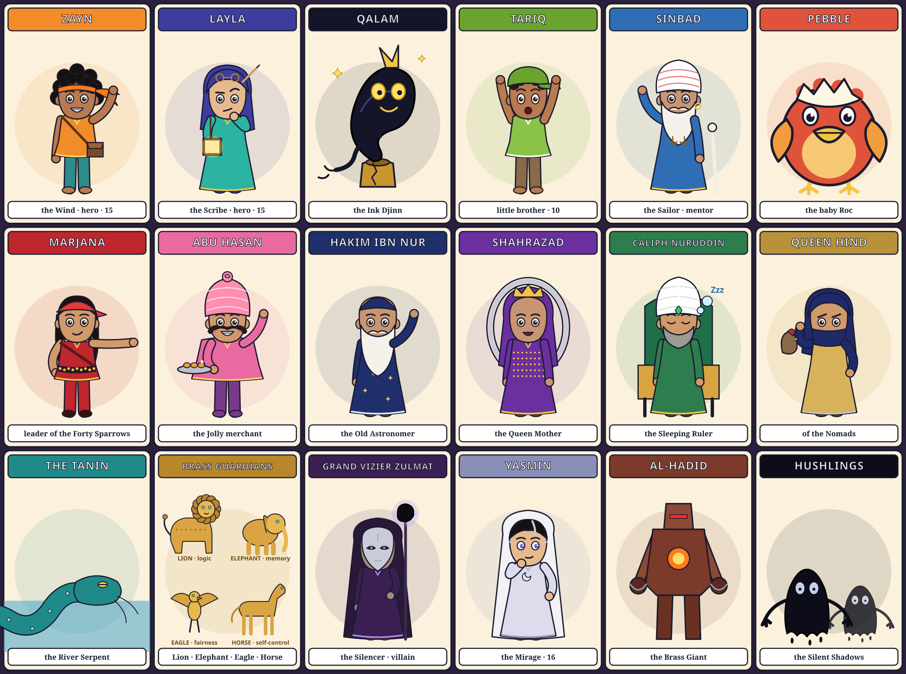

Every character has a **fixed look** (the "visual keys") so that they stay recognizable on all 100 pages and in every AI-generated image. Each one also has a **signature color**, which is the color of their speech-bubble border in the comic.

**Style prefix for every AI prompt** (paste it before each character prompt):
> *Vibrant modern comic-book illustration, Arabian Nights fantasy, mythic medieval Baghdad, bold clean ink outlines, cel shading, warm jewel-tone palette (saffron, teal, indigo, gold), expressive faces, dynamic pose, aimed at teenagers, full-body character sheet on a plain parchment background, no text.*

---

## THE HEROES

### 1. Zayn al-Rih — "Zayn of the Wind"
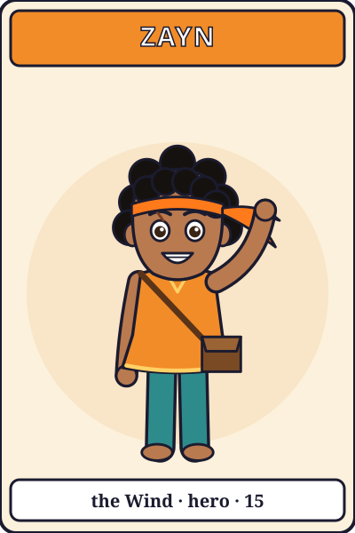
- **Role:** main hero. **Age:** 15. **Color:** saffron orange.
- **Visual keys:** wild black curly hair held back by an orange headband with a tail that streams behind him when he runs, brown skin, a scar through his left eyebrow, a sleeveless saffron tunic, patched teal trousers, barefoot with wrapped ankles, a courier's leather satchel across his chest.
- **Personality:** impetuous, funny, loyal and fearless on rooftops. He jumps first and thinks second. He hides that he can barely read by making jokes.
- **How he learns:** by *doing and moving*. He is the **Link-method** kid: he remembers the crazy action pictures.
- **Arc:** from a boy ashamed of not reading to the one who writes the saga's final page.
- **Catchphrase:** *"Faster than a rumor!"*
- **AI prompt:** *15-year-old Middle-Eastern boy, wild black curly hair, orange headband with long trailing tails, small scar through left eyebrow, sleeveless saffron tunic, patched teal trousers, wrapped ankles, barefoot, leather courier satchel, mid-leap across a rooftop, cocky grin.*

### 2. Layla bint Shahrazad
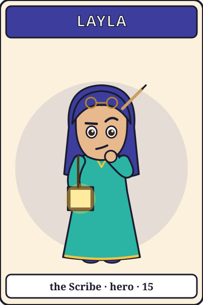
- **Role:** co-hero, apprentice scribe at the House of Wisdom, and granddaughter of Shahrazad. **Age:** 15. **Color:** indigo.
- **Visual keys:** a loose indigo headscarf with a reed pen tucked behind her ear, one long black braid over her shoulder, a turquoise robe spotted with ink, round brass spectacles pushed up on her head, and the **Satchel of Empty Pages**, a book on a strap that glows as it fills.
- **Personality:** brilliant, skeptical, diligent and a bit of a know-it-all. She is terrified of heights and secretly lonely.
- **How she learns:** by *reading and organizing*. She is the **Loci-method** kid: she files everything into places.
- **Arc:** learns to trust people who learn differently, and to jump.
- **Catchphrase:** *"Actually, the precise word is…"*
- **AI prompt:** *15-year-old girl scholar, loose indigo headscarf, reed pen tucked behind ear, long black braid, ink-spotted turquoise robe, round brass spectacles on forehead, carrying a glowing leather book on a strap, skeptical raised eyebrow.*

### 3. Qalam — the Ink Djinn
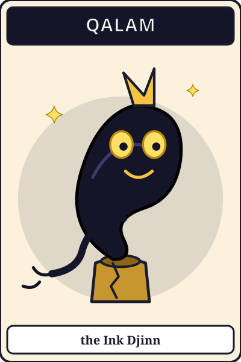
- **Role:** magical companion. **Age:** about 1,000 years. **Color:** ink black with gold.
- **Visual keys:** a body of flowing black ink shaped like a swirl of calligraphy, two large glowing gold eyes, a gold pen-nib crest on his head, and a tail that trails off into letters. He lives in a cracked brass inkwell.
- **Power:** he can **shape-shift into whatever a word means**, but only if the person holding its spark truly understands it. This is how the comic *shows* each word's meaning.
- **Personality:** dramatic, whimsical and eloquent, a theatrical show-off who is secretly afraid of being "blank".
- **Catchphrase:** *"Say it true, and I'll become it!"*
- **AI prompt:** *small friendly djinn made of flowing black ink shaped like Arabic-style calligraphy swirls, big glowing golden eyes, golden pen-nib crest, tail dissolving into ornamental letter shapes, rising out of a cracked brass inkwell, playful.*

### 4. Tariq
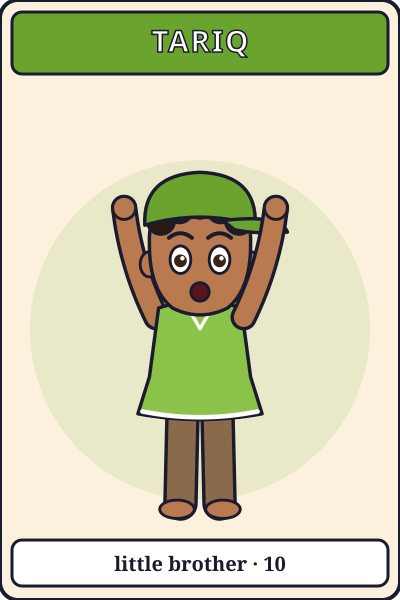
- **Role:** Zayn's little brother. **Age:** 10. **Color:** lime green.
- **Visual keys:** a mop of curls, missing front tooth, an oversized green cap, pockets stuffed with junk (spoons, shells, a string of beads).
- **Personality:** chatty, curious and gregarious. He collects *everything*. He is kidnapped in Ch. 30 and rescued in Ch. 88.
- **AI prompt:** *10-year-old boy, mop of curls, missing front tooth, oversized lime-green cap, bulging pockets full of trinkets, huge curious eyes.*

### 5. Sinbad the Sailor
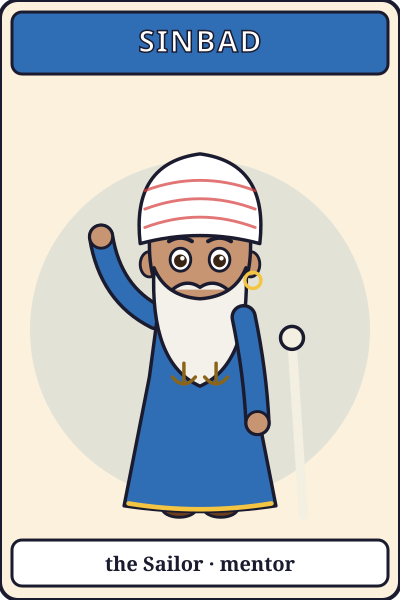
- **Role:** mentor. He is a legendary sailor, now 70 and grounded. **Color:** sea blue.
- **Visual keys:** a huge white beard braided into two anchors, a red-and-white striped turban, a gold hoop earring, a faded blue sea-coat covered in patches from seven voyages, and a whale-bone walking stick.
- **Personality:** a flamboyant raconteur who exaggerates everything, so nobody believes him, even when he tells the truth. He is brave underneath the bragging.
- **Signature:** his tall tales make **Pebble grow**, which puts *exaggeration* to work in the story.
- **Catchphrase:** *"And that, my lad, is only the SMALL version."*
- **AI prompt:** *70-year-old legendary sailor, enormous white beard braided into two anchor shapes, red-and-white striped turban, gold hoop earring, faded patched blue sea-coat, whale-bone walking stick, telling a story with wide theatrical arms.*

### 6. Pebble — the Roc
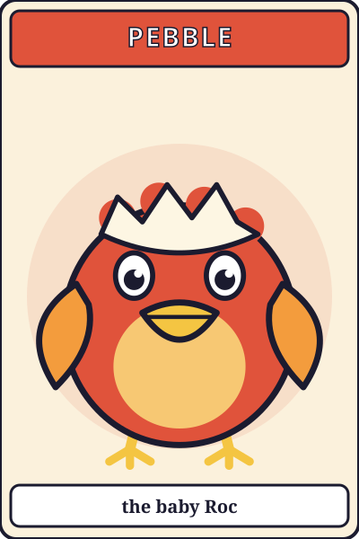
- **Role:** animal sidekick. He hatches from Sinbad's egg in Ch. 12. **Color:** sunset red.
- **Visual keys:** a fluffy chick with sunset-red and gold feathers, a comically large beak, and eggshell still stuck on his head. He grows from goat-size to house-size over the saga.
- **Personality:** loyal and hungry. He only understands tones of voice, not words.
- **AI prompt:** *adorable giant baby roc bird, fluffy sunset-red and gold down feathers, oversized beak, half an eggshell on its head, goat-sized, clumsy.*

### 7. Marjana & the Forty Sparrows
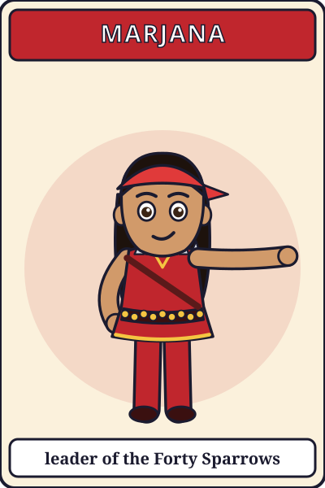
- **Role:** ally and leader of the Forty Sparrows, an orphan gang that steals only from thieves. **Age:** 16. **Color:** crimson.
- **Visual keys:** a crimson bandana, a gold coin-chain belt, six throwing knives in a bandolier, a dancer's flowing crimson trousers, and a confident smirk. Each Sparrow wears a single grey feather.
- **Personality:** pragmatic, sharp-tongued, and the best planner in the city.
- **AI prompt:** *16-year-old street-gang leader and dancer, crimson bandana, gold coin-chain belt, bandolier of throwing knives, flowing crimson trousers, smirking, backed by a crowd of orphan kids each wearing a grey feather.*

### 8. Abu Hasan the Jolly
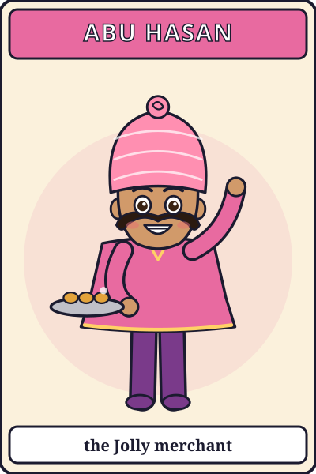
- **Role:** comic relief, the sweets and spice merchant of the Karkh Bazaar. **Color:** pink.
- **Visual keys:** round as a watermelon, an enormous pink turban with a sugar-rose on top, a curled moustache, sticky fingers, and a tray of honey-pastries.
- **Personality:** jovial, a gossip and a glutton. He plays pranks, and his heart is gold.
- **AI prompt:** *very round jolly merchant, huge pink turban topped with a sugar rose, curled moustache, embroidered vest, holding a tray of glistening honey pastries, belly laugh.*

### 9. Hakim Ibn Nur — the Old Astronomer
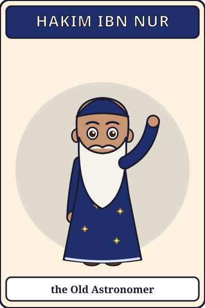
- **Role:** mentor. He is turned to stone in Ch. 1 and freed in Ch. 84. **Color:** silver.
- **Visual keys:** tall and thin, a long silver beard, a dark blue robe embroidered with stars, and a brass astrolabe hanging on his chest.
- **Personality:** benevolent, calm and cryptic. He speaks in clues.
- **AI prompt:** *tall thin elderly astronomer, long silver beard, dark-blue robe embroidered with constellations, brass astrolabe pendant, kind wise eyes.*

### 10. Shahrazad — the Queen Mother
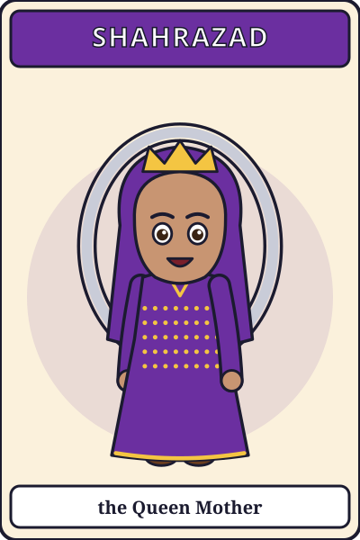
- **Role:** keeper of the Lexicon, frozen voiceless in the palace. She can speak through Layla's hand-mirror for one minute each night. **Color:** royal purple.
- **Visual keys:** an elderly queen, a purple veil with a thin gold crown, 1001 tiny gold beads stitched on her shawl, and kind laughing eyes. She appears inside a silver hand-mirror.
- **AI prompt:** *elderly wise queen storyteller, purple veil under a thin gold crown, shawl stitched with tiny gold beads, warm smile, seen inside an ornate silver hand mirror.*

### 11. Caliph Nuruddin
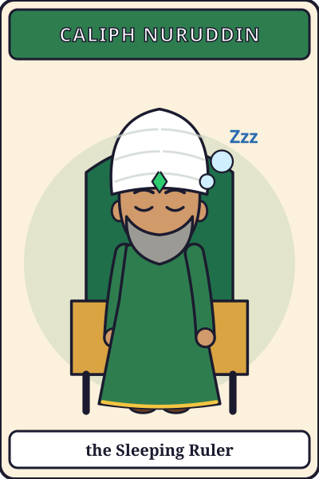
- **Role:** the ruler of the city, asleep under a spell until Ch. 96. **Color:** green.
- **Visual keys:** a green robe, a tall white turban with an emerald, a neat grey beard, and snoring bubbles.
- **AI prompt:** *kindly middle-aged caliph asleep on a throne, green robe, tall white turban with emerald, neat grey beard, magical snoring bubbles.*

### 12. Queen Hind of the Nomads
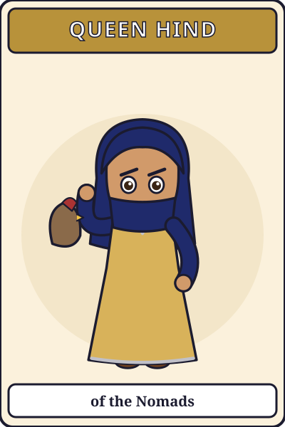
- **Role:** proud ruler of the desert tribes. She is won over in Ch. 64. **Color:** sand gold.
- **Visual keys:** an indigo face-veil and dark kohl eyes, silver jewelry, and a hooded falcon on her arm.
- **AI prompt:** *regal nomad queen of the desert, indigo veil, dark kohl-lined eyes, heavy silver jewelry, hooded falcon on gauntlet, standing before tents and dunes.*

### 13. The Tanin — the River Serpent
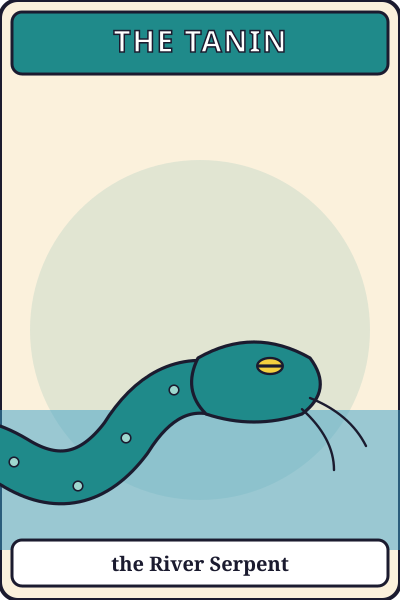
- **Role:** an ancient monster of the Tigris. He swallows the heroes in Ch. 18 and returns as an ally in the finale. **Color:** river teal.
- **Visual keys:** a colossal teal serpent with barnacles, whiskers like a catfish, sleepy yellow eyes, and a lighthouse-sized head.
- **AI prompt:** *colossal ancient teal river serpent rising from a river, barnacle-covered scales, long catfish whiskers, sleepy enormous yellow eyes, boats tiny in comparison.*

### 14. The Four Brass Guardians
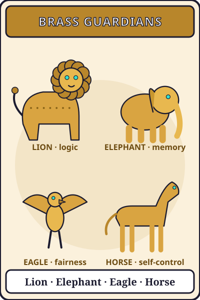
- **Role:** living gate statues of the Round City, each testing one virtue: the **Lion** (Basra, logic), the **Elephant** (Kufa, memory), the **Eagle** (Syrian, fairness) and the **Horse** (Khurasan, self-control).
- **Visual keys:** polished brass bodies with rivets, gears visible in the joints, and glowing turquoise eyes.
- **AI prompt:** *four giant living brass automaton statues (lion, elephant, eagle, horse), riveted polished brass, visible gears at joints, glowing turquoise eyes, guarding ornate city gates.*

---

## THE VILLAINS

### 15. Grand Vizier Zulmat, the Silencer (once "Idris")
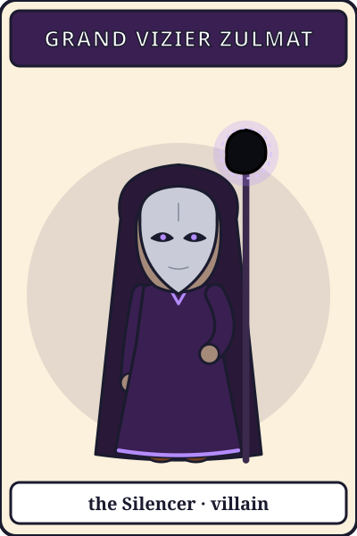
- **Role:** main villain. **Color:** violet-black.
- **Visual keys:** very tall and thin, sweeping violet-black robes that fade into smoke at the hem, a **silver mask with no mouth**, and a staff topped with the **Hush Stone**, a black meteor ringed with a pale ghost-glow.
- **Backstory:** as a 15-year-old he stammered through a poem at the Poets' Café and the whole court laughed. He swore that one day only *his* words would exist.
- **Personality:** cold, eloquent in writing, and speechless in public. His speech bubbles are **written on scrolls**, never spoken.
- **Arc:** redeemed when the city finally *listens* to him (Ch. 100).
- **AI prompt:** *very tall thin sorcerer-vizier, sweeping violet-black robes dissolving into smoke at the hem, featureless silver mask without a mouth, staff topped with a black meteorite stone glowing with pale ghost light, menacing and elegant.*

### 16. Yasmin — "the Mirage"
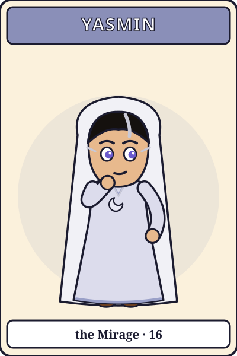
- **Role:** Zulmat's apprentice, a shapeshifter who becomes an ally in Ch. 70. **Age:** 16. **Color:** pearl white.
- **Visual keys:** a hooded cloak of white heron feathers, silver eyeliner in sharp wings, one grey streak in her black hair, and a crescent pendant. When she shapeshifts, her outline shimmers like desert heat.
- **Personality:** enigmatic and witty. She is an orphan who is desperate to be valued.
- **AI prompt:** *16-year-old enigmatic girl shapeshifter, hooded cloak made of white heron feathers, sharp silver winged eyeliner, black hair with one grey streak, crescent-moon pendant, outline shimmering like heat haze.*

### 17. Al-Hadid — the Brass Giant
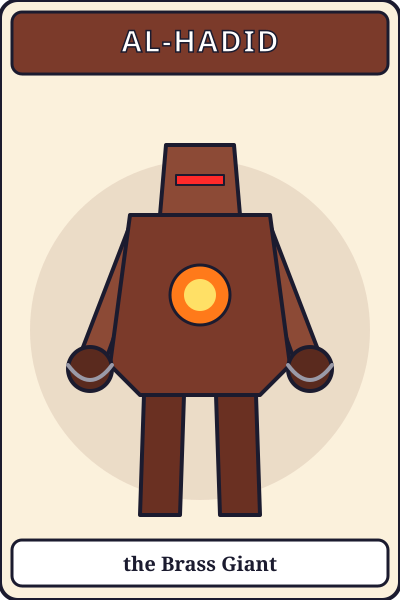
- **Role:** Zulmat's general, a war automaton three stories tall. **Color:** rust red.
- **Visual keys:** a dented iron-and-brass body, a furnace glowing in its chest, a single red eye-slit, and chains wrapped around its fists.
- **AI prompt:** *three-story-tall iron-and-brass war automaton, dented armor, glowing furnace in its chest, single red eye slit, chains wrapped around its fists, steam venting.*

### 18. The Hushlings
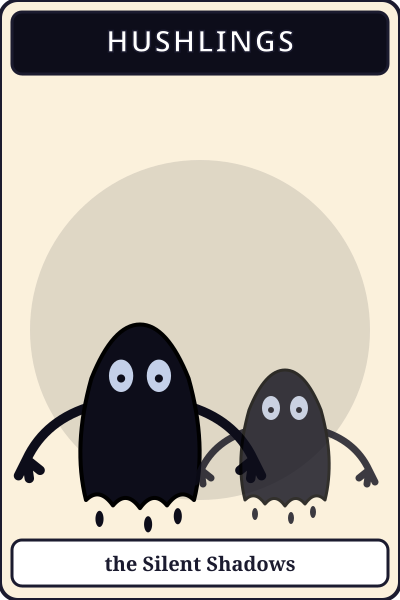
- **Role:** the foot-soldiers, shadow creatures made of spilled ink.
- **Visual keys:** wobbling inky black blobs with two pale hollow eyes and **no mouth**, and dripping hands. Wherever they pass, everything turns grey.
- **AI prompt:** *creepy but kid-friendly shadow creatures made of dripping black ink, no mouths, pale hollow glowing eyes, long dripping fingers, turning colorful surroundings grey where they touch.*

---

## Minor Characters (in order of appearance)

| Character | Chapter | One-line description |
|---|---|---|
| Customs Chief Bakhil | 4 | a venal tax collector who charges a "truth tax" on sparks |
| Farah the clerk | 4 | a young clerk with integrity who exposes Bakhil |
| Rashid the Harbormaster | 9 | a taciturn old man who guards the silent bell |
| Umm Qasim the Ferry-woman | 15 | a frugal, miserly old ferry-woman who haggles over every crossing |
| Hamid & Majid, the Watermelon Twins | 16 | two feuding farmer brothers |
| Silver-Tongue the Auctioneer | 22, 30, 88, 91 | Zulmat's smooth-talking agent, who kidnaps Tariq |
| Ibn Warraq the Bookseller | 25 | an erudite, very verbose old scholar |
| Master Nasr the Coppersmith | 26 | a strident smith who forges the decoy Satchel |
| Jabir the Poet | 35 | the café's smug champion, later Zayn's friend |
| Captain Hamza | 43 | a stoic guard captain, half turned to stone |
| Dr. Rufaida | 44 | head physician of the bimaristan |
| Master Hadid the Blacksmith | 47 | forges Layla's pen-sword |
| Umm Nur | 49 | Hakim's reclusive sister, living under the city |
| Master Banu the Clockmaker | 55 | the inventor whose automatons were stolen |
| Sitt Zubayda the Bookbinder | 56 | binds the kids' stories into an anthology |
| Farouk the Dyer | 59 | the insurgent who leads the colorful rebellion |
| Rashid ibn Hind | 63 | Queen Hind's son and Zayn's camel-race rival |
| Ibn Yunus the Astrolabe-maker | 54 | maps the fallen sparks like comets |
| Prince Karim | 82 | a spoiled, listless prince who finally wakes up |
